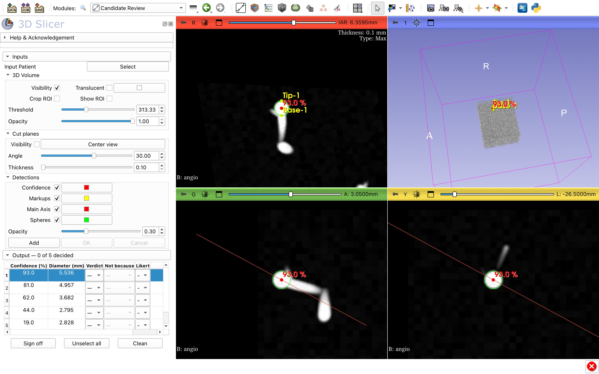

# ReformatViz — candidate review for 3D Slicer

> Mirrored from the original repository at
> [gitlab.inria.fr/yassis/slicer-reformat-aneurysm](https://gitlab.inria.fr/yassis/slicer-reformat-aneurysm),
> developed at the [Loria](https://www.loria.fr/) lab.

A [3D Slicer](https://www.slicer.org/) extension for reviewing a detector's candidates — such
as intracranial aneurysms on head angiography — one at a time.

**The slice view always contains the candidate's axis.** You spin the view around that axis
instead of hunting for an oblique plane by hand, then record a verdict, and add anything the
detector missed.



## Install

Developed against **3D Slicer 5.12.3**. Nothing else: Slicer supplies everything the module
uses.

```bash
git clone https://github.com/youssefassis/slicer-aneurysm-review.git
```

In Slicer, open *Edit → Application Settings → Modules*, add the inner `ReformatViz/`
directory (the one containing `ReformatViz.py`) to **Additional module paths**, and restart.
The module appears as **Candidate Review**, under *Annotation*.

## Quick start

1. **Select** a case directory holding one `*.nii.gz` volume and one detection `*.json`.
2. Click a row to review that candidate. **Angle** spins the view around its axis.
3. Record a verdict — **Yes**, **No** (with a reason), **Uncertain** or **Not assessable** —
   with an optional Likert score and note. **Add** places two points (base, then tip) for a
   finding the detector missed.
4. **Sign off** once every candidate is decided. There is nothing to save: the review is
   written to `review_<reviewer>.json` beside the case as you work.

No data to try it on? A synthetic sample case ships in [`data/`](data/README.md).

## Features

- Oblique, maximum-intensity-projection slab around each candidate's axis.
- An autosaved review per reviewer, resumed when the case is reopened.
- Rejection reasons, Likert scores and notes per candidate; your own additions kept apart.
- Sign-off with provenance and an append-only audit trail, for validation studies.
- Never writes to the detection file, and leaves the rest of your scene alone.

## Documentation

- [User guide](docs/user-guide.md) — every control, in the reviewer's terms.
- [Detection format](docs/detection-format.md) — the JSON the module reads, for detector authors.
- [Review format](docs/review-format.md) — the JSON the module writes.
- [Development](docs/development.md) — running the tests and contributing.

## Credits

Developed by Youssef Assis, maintained by Erwan Kerrien
([Loria](https://www.loria.fr/), Université de Lorraine, CNRS, Inria).

Licensed under [Apache 2.0](LICENSE).
